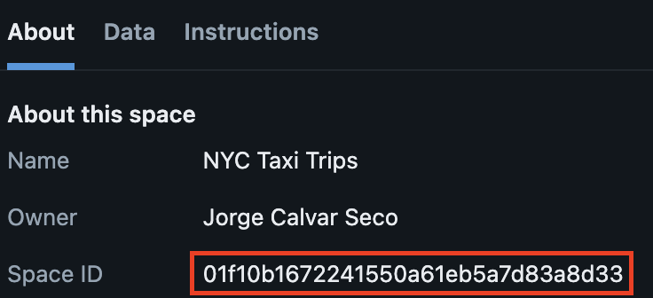
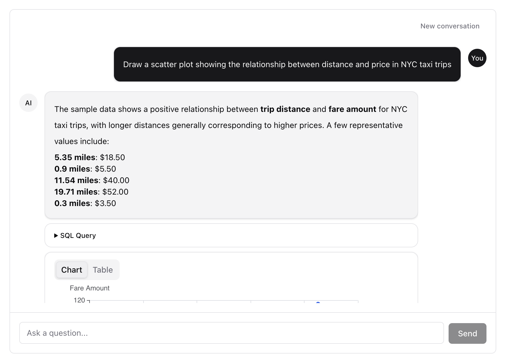

# Genie plugin

Integrates [Databricks AI/BI Genie](https://docs.databricks.com/en/genie/index.html) spaces into your AppKit application, enabling natural language data queries via a conversational interface.

**Key features:**
- Named space aliases for multiple Genie spaces
- SSE streaming with real-time status updates
- Conversation history replay with automatic reconnection
- Query result attachment fetching
- Agent mode: the agent's reasoning, streamed as it works, and the charts it draws
- On-behalf-of (OBO) user execution

## Basic usage

```ts
import { createApp, genie, server } from "@databricks/appkit";

await createApp({
  plugins: [
    server(),
    genie(),
  ],
});
```

## Configuration options

| Option | Type | Default | Description |
|--------|------|---------|-------------|
| `spaces` | `Record<string, string>` | `{ default: DATABRICKS_GENIE_SPACE_ID }` | Map of alias names to Genie Space IDs |
| `agents` | `Record<string, string>` | `{}` | Map of alias names to Genie Space IDs used in [agent mode](#agent-mode) |
| `timeout` | `number` | `120000` | Polling timeout in ms. Set to `0` for indefinite |

### Space aliases

Space aliases let you reference multiple Genie spaces by name. The alias is used in API routes and the frontend `<GenieChat>` component:

```ts
genie({
  spaces: {
    sales: "01ABCDEF12345678",
    support: "01GHIJKL87654321",
  },
});
```

If you omit `spaces`, the plugin reads `DATABRICKS_GENIE_SPACE_ID` from the environment and registers it under the `default` alias.

### Agent mode

Genie agent mode answers like an agent: it reasons about the question, runs queries, and draws charts. Register a space under `agents` instead of `spaces` to use it in agent mode. Any Genie space can be used as an agent:

```ts
genie({
  spaces: { sales: "01ABCDEF12345678" },
  agents: { analyst: "01ABCDEF12345678" },
});
```

An agent alias works with the same routes, the same `sendMessage` and `getConversation` exports, and the same `<GenieChat alias="analyst" />` component as a chat space. The difference is in what it returns:

- `reasoning` events stream the agent's reasoning while it works. The completed message carries the steps in `reasoning`.
- Charts arrive as `viz` attachments. The [visualization endpoint](#get-a-visualization) serves each one as a PNG, and `GenieChat` shows it in place of the chart it would otherwise infer from the query result.

An alias can be either a chat space or an agent, not both. To use one space both ways, give it two aliases, as in the example above. Conversations don't carry over between the two modes.

Agent mode uses the Genie agent API (`/api/2.0/genie/agents/{id}/responses` and `/api/2.0/genie/agents/{id}/conversations/{id}/items`), which the Databricks SDK doesn't cover yet.

### Finding your Genie Space ID

You can find the Space ID from the **About** tab on your Genie space page in Databricks:

<div style={{maxWidth: 400}}>



</div>

## Environment variables

| Variable | Description |
|----------|-------------|
| `DATABRICKS_GENIE_SPACE_ID` | Default Genie Space ID (used when `spaces` config is omitted) |

## HTTP endpoints

The genie plugin exposes these endpoints (mounted under `/api/genie`):

- `POST /api/genie/:alias/messages` — Send a message to a Genie space (SSE stream)
- `GET /api/genie/:alias/conversations/:conversationId` — Replay conversation history (SSE stream)
- `GET /api/genie/:alias/conversations/:conversationId/messages/:messageId/attachments/:attachmentId/visualization` — Download a chart as a PNG

### Send a message

```
POST /api/genie/:alias/messages
Content-Type: application/json

{
  "content": "What were total sales last quarter?",
  "conversationId": "optional-existing-conversation-id"
}
```

The response is an SSE stream that emits these event types:

| Event type | Description |
|------------|-------------|
| `message_start` | Conversation and message IDs assigned |
| `status` | Processing status updates (e.g. `ASKING_AI`, `EXECUTING_QUERY`) |
| `reasoning` | Agent mode only: one step of the agent's reasoning |
| `message_result` | Final message with text and query attachments |
| `query_result` | Tabular data for a query attachment |
| `error` | Error details |

### Get conversation history

```
GET /api/genie/:alias/conversations/:conversationId
```

Returns an SSE stream of `message_result` and `query_result` events for all messages in the conversation.

### Get a visualization

```
GET /api/genie/:alias/conversations/:conversationId/messages/:messageId/attachments/:attachmentId/visualization
```

Returns the PNG Genie rendered for a `viz` attachment, so it can be used directly as an `` source. Use the `attachmentId` of the `viz` attachment, not its `queryAttachmentId`. The message must be completed.

## Programmatic access

The plugin exports `sendMessage` and `getConversation` for server-side use:

```ts
const AppKit = await createApp({
  plugins: [server(), genie({ spaces: { demo: "space-id" } })],
});

// Stream events
for await (const event of AppKit.genie.sendMessage("demo", "Show revenue by region")) {
  console.log(event.type, event);
}

// Fetch full conversation
const history = await AppKit.genie.getConversation("demo", "conversation-id");
```

## Frontend components

The `@databricks/appkit-ui` package provides ready-to-use React components for Genie:

### GenieChat

A full-featured chat interface that handles streaming, history, and reconnection:



```tsx
import { GenieChat } from "@databricks/appkit-ui/react";

function GeniePage() {
  return (
    <div style={{ height: 600 }}>
      <GenieChat alias="demo" />
    </div>
  );
}
```

The `alias` prop must match a key in the `spaces` configuration on the server.

### useGenieChat hook

For custom chat UIs, use the `useGenieChat` hook directly:

```tsx
import { useGenieChat } from "@databricks/appkit-ui/react";

function CustomChat() {
  const { messages, status, sendMessage, reset } = useGenieChat({
    alias: "demo",
  });

  return (
    <>
      {messages.map((msg) => (
        <div key={msg.id}>{msg.content}</div>
      ))}
      <button onClick={() => sendMessage("Show top customers")}>Ask</button>
      <button onClick={reset}>New conversation</button>
    </>
  );
}
```

See the [GenieChat](../api/appkit-ui/genie/GenieChat.mdx) component reference for the full props API.
